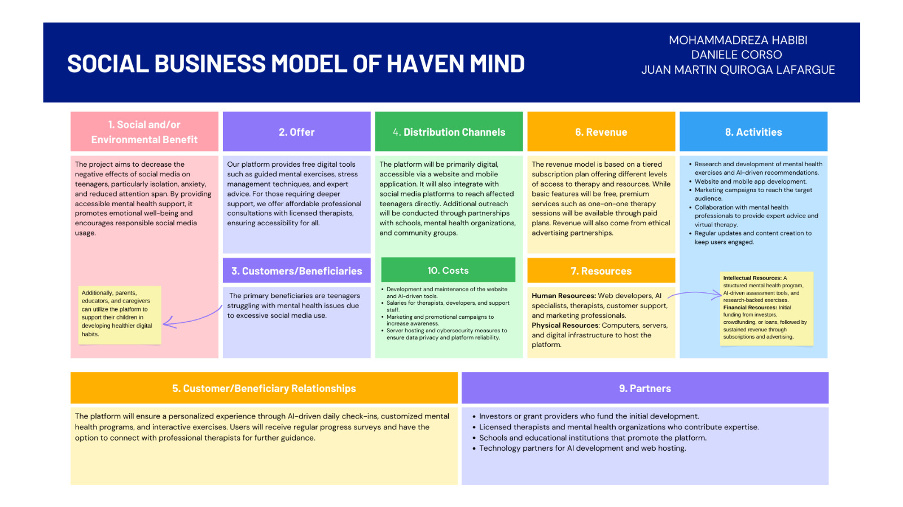
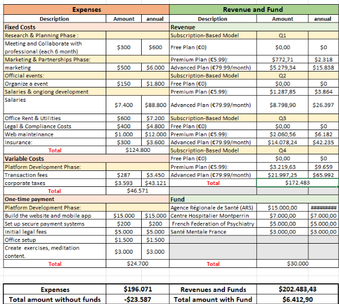

# Haven Mind — Digital Youth Mental Health Platform

**Live Website:** https://danielecorso00.github.io/Haven-Mind/

## About the Project
Haven Mind is a project management plan created during my Erasmus+ exchange at **Aix-Marseille Université** (France, 2025). 

The goal of the project is to design a simple, accessible digital platform to help teenagers and young adults (aged 16–25) deal with anxiety and stress. To make it affordable for students, the platform combines free self-help exercises, peer support groups, and low-cost online therapy funded through partnerships with universities and local health organizations.

## What I Worked On
Working in a team of four students, I focused mainly on:
* **Project Planning:** Defining the platform's goals, target audience (1,250 students in Year 1), and a 15-month launch roadmap.
* **Partnerships:** Identifying local universities, hospitals, and non-profits to support and fund the service.
* **Business Model & Budget:** Helping structure the Social Business Model Canvas and the first-year financial plan ($196k total budget).
* **Website Prototype:** Building a simple web demo to show how the platform works in practice.

## Project Visuals

### Social Business Model Canvas

### Financial Budget

## Files in This Repository
* `Haven Mind Project Management Final Report.pdf` — The full project report.
* `index.html` — The code for the live website prototype.
* `screenshots/` — Images of the Business Model Canvas and the Excel budget.

---
*Team: Daniele Corso, Mohammadreza Habibi, Juan Martin Quiroga Lafargue, Tom Scaramanga (Aix-Marseille Université, 2025).*
